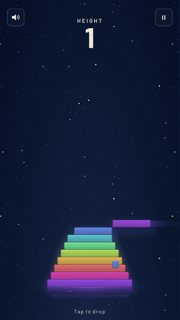
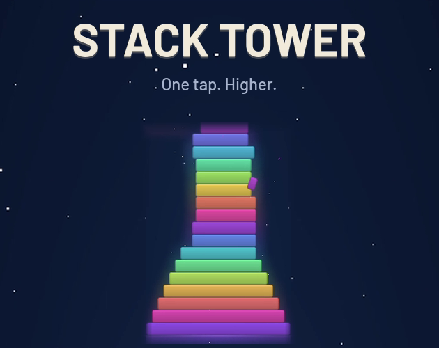

# Stack Tower

**One tap. Higher.** A hyper-casual stacking game for mobile and web, made in Unity.

▶ **Play it in your browser:** https://wallasace.itch.io/stack-tower

  
  &nbsp;&nbsp;
  

## How to play

- Tap (or press Space) to drop the moving block onto the tower.
- Whatever hangs over the edge is cut off — the tower gets narrower.
- Land a **PERFECT** drop three times in a row and the block grows back.
- The game ends when you miss the tower completely.

## Features

- Colorful blocks that shift hue as the tower grows, with a soft backlight glow and floor reflection
- Main menu, pause, game over, credits and a local **top-10 ranking** (saved on the device)
- Procedural sound effects and chiptune soundtrack, synthesized at runtime — no audio files
- All visuals generated in code (gradients, rounded shapes, glow) — no imported art
- Responsive layout: works on phones (safe area / notch), desktop and the web (full-screen WebGL template)
- Auto-pause when the app loses focus; in-game sound toggle

## Tech

- **Unity 6.3 LTS** (6000.3.14f1), C#
- uGUI built entirely from code (`Shell.cs`), shared with [Lane Dash](https://github.com/wallasace/lane-dash)
- Runtime audio synthesis (`Sfx.cs`, `Music.cs`) and "juice" effects (`Juice.cs`: screen shake, particles, pop)
- Visual tuning panel in the editor: **Tools > Ajustes Visuais**

## Running the project

1. Open the folder in **Unity Hub** (*Add project from disk*) with Unity 6000.3.14f1.
2. Open `Assets/Scenes/Main.unity` and press **Play**. Everything is created at runtime.
3. Web build: *File > Build Profiles > Web*. The project ships with a responsive WebGL template.

## Credits

- Created by **wallasace** — [X / Twitter](https://x.com/wall_as_ace) · [GitHub](https://github.com/wallasace)
- Music and sound effects: wallasace (generated in code)
- Typeface: [Barlow](https://github.com/jpt/barlow) by Jeremy Tribby — SIL Open Font License 1.1
- X and GitHub icons: [Simple Icons](https://simpleicons.org) (CC0); trademarks of their owners
